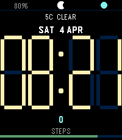

<!-- Generated by scripts/update_app_directory.py: do not edit by hand -->
[← All Pebble Developers](../developers.md)

# Ryphon

*2 watchfaces · Last updated 2026-10-11 · [About these lists](../about-app-lists.md)*

Links: [Pebble App Store](https://apps.repebble.com/apps/dev/ryphon_5b55fe4fca1d16000148cff3) · [Website (dragonfruit.dev)](https://dragonfruit.dev)

<button type="button" data-filter="all" aria-pressed="true">All 2</button><button type="button" data-filter="watchface" aria-pressed="false">Watchfaces 2</button><button type="button" data-filter="watchapp" aria-pressed="false" disabled>Apps 0</button>

<label class="dev-sort">Sort by <select><option value="updated">Recently updated</option><option value="released">Newest release</option><option value="title">A–Z</option></select></label>

<h2 class="app-name" id="app-8e385b4474424c4396850292"><a href="https://apps.repebble.com/8e385b4474424c4396850292">Pulfrich Time</a> v1.0</h2>
<a class="app-source" href="https://git.dragonfruit.dev/ryphon/pulfrichtime" title="Source code" data-search-exclude>View source</a>

Watchface

Released 2026-04-15 Updated 2026-04-15

Runs on: Round 2, Time 2

Heavily inspired by work from Branta Games (https://www.youtube.com/@brantagames). Branta put out some really cool videos about an effect they were working on where the pixels would move in…

<h2 class="app-name" id="app-c373c5be6b7a48d482aa1656"><a href="https://apps.repebble.com/c373c5be6b7a48d482aa1656">SuperSegments</a> v1.1.2</h2>
<a class="app-source" href="https://git.dragonfruit.dev/ryphon/supersegments" title="Source code" data-search-exclude>View source</a>

Watchface

Released 2026-04-03 Updated 2026-04-04

Runs on: Round 2, Time 2

Inspired by the Segment34 watch face for Garmin. I&#x27;m slowly realizing my Garmin is not going to last long enough, but I want to be able to see and use the watch faces that I can while I can. And…

