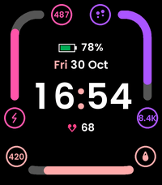
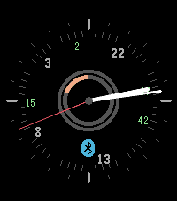

<!-- Generated by scripts/update_app_directory.py: do not edit by hand -->
[← All Pebble Developers](../developers.md)

# Rythm.Run

*2 watchfaces · Last updated 2026-11-09 · [About these lists](../about-app-lists.md)*

Links: [Pebble App Store](https://apps.repebble.com/apps/dev/rythm-run_1be61dccc9848d8be9f4a808) · [GitLab (rythm-run)](https://gitlab.com/rythm-run) · [GitLab (glejeune)](https://gitlab.com/glejeune) · [Website (rythm.run)](https://rythm.run)

<button type="button" data-filter="all" aria-pressed="true">All 2</button><button type="button" data-filter="watchface" aria-pressed="false">Watchfaces 2</button><button type="button" data-filter="watchapp" aria-pressed="false" disabled>Apps 0</button>

<label class="dev-sort">Sort by <select><option value="updated">Recently updated</option><option value="released">Newest release</option><option value="title">A–Z</option></select></label>

<h2 class="app-name" id="app-b65b9d3eb9874d8eb499770c"><a href="https://apps.repebble.com/b65b9d3eb9874d8eb499770c">Goals</a> v0.1.4</h2>
<a class="app-source" href="https://gitlab.com/rythm-run/goals.pebble" title="Source code" data-search-exclude>View source</a>

Watchface

bsd-3-clause Released 2026-10-30 Updated 2026-11-07

Runs on: Round 2, Time 2

Goals is a modern, clean, and highly readable activity watchface engineered specifically for new-generation Pebble smartwatches: Pebble Time 2 (200x228 rounded rectangle) and Pebble Round 2…

<h2 class="app-name" id="app-185fd3518b98492a957c25d7"><a href="https://apps.repebble.com/185fd3518b98492a957c25d7">elbbep</a> v1.0</h2>
<a class="app-source" href="https://gitlab.com/glejeune/elbbep" title="Source code" data-search-exclude>View source</a>

Watchface · <a href="https://forum.rebble.io/t/857" title="Discuss this app on the Rebble forum" data-search-exclude>Forum thread</a>

bsd-3-clause Released 2026-04-12 Updated 2026-04-12

Runs on: Round 2, Time 2, Pebble 2 Duo, Pebble 2, Time Round, Time, Classic

A clean analog watchface with a 24-hour dial running anti-clockwise.

