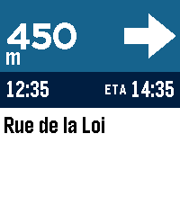

<!-- Generated by scripts/update_app_directory.py: do not edit by hand -->
[← All Pebble Developers](../developers.md)

# Sacha

*1 app · Last updated 2026-10-11 · [About these lists](../about-app-lists.md)*

Links: [Pebble App Store](https://apps.repebble.com/apps/dev/sacha_d20b893110bbd447f8a8a554) · [GitHub (optio)](https://github.com/optio)

<h2 class="app-name" id="app-ad4971e345854b909b73b1a9"><a href="https://apps.repebble.com/ad4971e345854b909b73b1a9">PebbleNTN - Maps Nav Notification To Navigation</a> v0.0.49</h2>
<a class="app-source" href="https://github.com/optio/PebbleNTN" title="Source code" data-search-exclude>View source</a>

App · <a href="https://forum.rebble.io/t/1172" title="Discuss this app on the Rebble forum" data-search-exclude>Forum thread</a>

Released 2026-07-16 Updated 2026-10-03

Runs on: Round 2, Time 2, Pebble 2 Duo, Pebble 2, Time Round, Time, Classic

Turn-by-turn directions from your phone&#x27;s nav app, on your pebble. PebbleNTN reads your navigation app&#x27;s notifications and shows the next turn, distance, road, and ETA on your Pebble. No need to…

