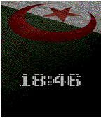

<!-- Generated by scripts/update_app_directory.py: do not edit by hand -->
[← All Pebble Developers](../developers.md)

# Safi

*1 watchface · Last updated 2026-10-12 · [About these lists](../about-app-lists.md)*

Links: [Pebble App Store](https://apps.repebble.com/apps/dev/safi_5758bcda9bcb707d9c00000a) · [GitHub (apotox)](https://github.com/apotox) · [Website (iotroid.online)](https://www.iotroid.online)

<h2 class="app-name" id="app-57d5928effca4965f400027f"><a href="https://apps.repebble.com/57d5928effca4965f400027f">dzwatch</a> v1.0</h2>
<a class="app-source" href="https://github.com/apotox/dzwatch" title="Source code" data-search-exclude>View source</a>

Watchface

MIT Released 2016-09-11 Updated 2016-09-11

Runs on: Time 2, Time

Dzwatch a watchface with Algeria flag background

