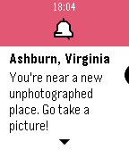

<!-- Generated by scripts/update_app_directory.py: do not edit by hand -->
[← All Pebble Developers](../developers.md)

# Sage Ross

*1 watchface · Last updated 2026-10-12 · [About these lists](../about-app-lists.md)*

Links: [Pebble App Store](https://apps.repebble.com/apps/dev/sage-ross_57801d326c21044501000e1d) · [GitHub (ragesoss)](https://github.com/ragesoss)

<h2 class="app-name" id="app-57dc94602a6ea665510000f0"><a href="https://apps.repebble.com/57dc94602a6ea665510000f0">Diderot</a> v1.3</h2>
<a class="app-source" href="https://github.com/ragesoss/diderot" title="Source code" data-search-exclude>View source</a>

Watchface

Released 2016-09-17 Updated 2016-12-10

Runs on: Round 2, Time 2, Pebble 2 Duo, Pebble 2, Time Round, Time, Classic

Diderot shows you the nearest unphotographed Wikipedia article to you, along with the distance and direction. You&#x27;ll also get a notification whenever you&#x27;re near an unphotographed location that is…

