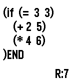

<!-- Generated by scripts/update_app_directory.py: do not edit by hand -->
[← All Pebble Developers](../developers.md)

# Sage V.

*1 app · Last updated 2026-10-12 · [About these lists](../about-app-lists.md)*

Links: [Rebble App Store](https://apps.rebble.io/en_US/developer/5ec1f90f3dd31081fc98fcde/1) · [GitLab (sagev9000)](https://gitlab.com/sagev9000) · [Website (patreon.com)](https://www.patreon.com/fronter)

<h2 class="app-name" id="app-5ec1f90f3dd31081fc98fce0"><a href="https://apps.rebble.io/en_US/application/5ec1f90f3dd31081fc98fce0">PebbLisp</a> v0.3</h2>
<a class="app-source" href="https://gitlab.com/sagev9000/pebblisp" title="Source code" data-search-exclude>View source</a>

App

Released 2020-05-18 Updated 2020-08-10 Rebble App Store

Runs on: Time 2, Pebble 2 Duo, Pebble 2, Time, Classic

A very simple LISP editor and interpreter called PebbLisp. Only supports the most basic LISP functionality, but still offers a somewhat usable set. Built-ins include `if`, `def`, `fn` (lambda)…

