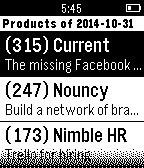

<!-- Generated by scripts/update_app_directory.py: do not edit by hand -->
[← All Pebble Developers](../developers.md)

# Sai Grandhi

*1 app · Last updated 2026-10-12 · [About these lists](../about-app-lists.md)*

Links: [Pebble App Store](https://apps.repebble.com/apps/dev/sai-grandhi_545484efe77c14970000003e) · [GitHub (saigrandhi)](https://github.com/saigrandhi) · [Website (grandhi.me)](http://grandhi.me)

<h2 class="app-name" id="app-54560feea13219611e000069"><a href="https://apps.repebble.com/54560feea13219611e000069">ProductHunter</a> v0.4</h2>
<a class="app-source" href="https://github.com/saigrandhi/PebHunter" title="Source code" data-search-exclude>View source</a>

App

Released 2014-11-02 Updated 2014-11-02

Runs on: Time 2, Pebble 2 Duo, Pebble 2, Time, Classic

Product Hunt application for Pebble watches

