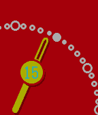

<!-- Generated by scripts/update_app_directory.py: do not edit by hand -->
[← All Pebble Developers](../developers.md)

# SAkira

*1 watchface · Last updated 2026-10-12 · [About these lists](../about-app-lists.md)*

Links: [Pebble App Store](https://apps.repebble.com/apps/dev/sakira_55102d35e0b81d20390000e3) · [GitHub (sakisakira)](https://github.com/sakisakira)

<h2 class="app-name" id="app-5513c6bb6f2fce780900008b"><a href="https://apps.repebble.com/5513c6bb6f2fce780900008b">Quarter Analogue Watch</a> v1.5</h2>
<a class="app-source" href="https://github.com/sakisakira/PebbleQuarterWatch" title="Source code" data-search-exclude>View source</a>

Watchface

Released 2015-03-26 Updated 2015-10-29

Runs on: Round 2, Time 2, Pebble 2 Duo, Pebble 2, Time Round, Time, Classic

A simple zoomed analogue watch. Oct30: ver.1.5 released Oct23: ver.1.4 released (1st release for color)

