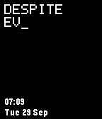
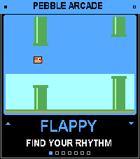
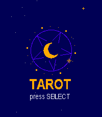

<!-- Generated by scripts/update_app_directory.py: do not edit by hand -->
[← All Pebble Developers](../developers.md)

# Salim Benhamadi

*1 watchface and 3 apps · Last updated 2026-10-11 · [About these lists](../about-app-lists.md)*

Links: [Pebble App Store](https://apps.repebble.com/apps/dev/salim-benhamadi_661d02d636de4056f2a5eada) · [GitHub (salim-benhamadi)](https://github.com/salim-benhamadi)

<button type="button" data-filter="all" aria-pressed="true">All 4</button><button type="button" data-filter="watchface" aria-pressed="false">Watchfaces 1</button><button type="button" data-filter="watchapp" aria-pressed="false">Apps 3</button>

<label class="dev-sort">Sort by <select><option value="updated">Recently updated</option><option value="released">Newest release</option><option value="title">A–Z</option></select></label>

<h2 class="app-name" id="app-31982194f0bb4f248a6a44fd"><a href="https://apps.repebble.com/31982194f0bb4f248a6a44fd">Undertale - Still You</a> v1.0.0</h2>
<a class="app-source" href="https://github.com/salim-benhamadi/Pebble-Undertale" title="Source code" data-search-exclude>View source</a>

Watchface

Released 2026-09-29 Updated 2026-09-29

Runs on: Round 2, Time 2, Pebble 2 Duo, Pebble 2, Time Round, Time, Classic

Undertale&#x27;s &quot;Despite everything, it&#x27;s still you.&quot; typed out in pixel letters, rewriting itself every minute.

<h2 class="app-name" id="app-53cbaca97e8944cab0749b1e"><a href="https://apps.repebble.com/53cbaca97e8944cab0749b1e">Red Flagr</a> v1.0.3</h2>
<a class="app-source" href="https://github.com/salim-benhamadi/Pebble-Red-Flagr" title="Source code" data-search-exclude>View source</a>

App

Released 2026-09-29 Updated 2026-09-29

Runs on: Round 2, Time 2, Pebble 2 Duo, Pebble 2, Time Round, Time, Classic

Would you like to know if he&#x27;s the one, or just one more red flag? Red Flagr is the magic 8-ball for your love life, and it lives on your wrist. Shake your Pebble and it reveals a red flag about…

<h2 class="app-name" id="app-1e8def94044d4f4ca69cc566"><a href="https://apps.repebble.com/1e8def94044d4f4ca69cc566">Pebble Arcade</a> v1.0.3</h2>
<a class="app-source" href="https://github.com/salim-benhamadi/Pebble-Arcade" title="Source code" data-search-exclude>View source</a>

App

Released 2026-09-28 Updated 2026-09-29

Runs on: Round 2, Time 2, Pebble 2 Duo, Pebble 2, Time Round, Time, Classic

Six retro arcade games in one app, playable with just your watch buttons. Pick a game from the menu, play a quick round, and hit SELECT to retry. Games Flappy: tap to flap through the pipes…

<h2 class="app-name" id="app-f10917da43df4fb78599e0b9"><a href="https://apps.repebble.com/f10917da43df4fb78599e0b9">Tarot</a> v1.2.0</h2>
<a class="app-source" href="https://github.com/salim-benhamadi/Pebble-Tarot" title="Source code" data-search-exclude>View source</a>

App

Released 2026-09-28 Updated 2026-09-28

Runs on: Round 2, Time 2, Pebble 2 Duo, Pebble 2, Time Round, Time, Classic

puts a full 78-card Rider-Waite deck on your wrist and lets the stars do the talking. Choose your reading: a Daily Card that stays yours all day, a quick Yes or No, Past, Present and Future, Mind…

