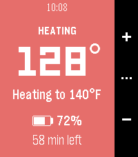

<!-- Generated by scripts/update_app_directory.py: do not edit by hand -->
[← All Pebble Developers](../developers.md)

# Saltpinch Creative Co

*1 app · Last updated 2026-11-23 · [About these lists](../about-app-lists.md)*

Links: [Pebble App Store](https://apps.repebble.com/apps/dev/saltpinch-creative-co_78324505d72077137d810f50) · [GitHub (aleminopuy)](https://github.com/aleminopuy)

<h2 class="app-name" id="app-de4aae95ef8042d7991fc38a"><a href="https://apps.repebble.com/de4aae95ef8042d7991fc38a">Emberio</a> v1.2.0</h2>
<a class="app-source" href="https://github.com/aleminopuy/emberio" title="Source code" data-search-exclude>View source</a>

App · <a href="https://forum.rebble.io/t/1527" title="Discuss this app on the Rebble forum" data-search-exclude>Forum thread</a>

MIT Released 2026-11-19 Updated 2026-11-21

Runs on: Round 2, Time 2, Pebble 2 Duo, Pebble 2, Time Round, Time, Classic

Your Ember mug on your Pebble. See your drink&#x27;s temperature and how many minutes of heat your mug&#x27;s battery has left, change the temperature from your wrist, and get a buzz when your drink is…

