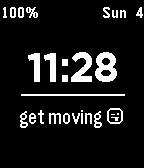
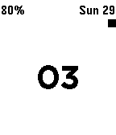

<!-- Generated by scripts/update_app_directory.py: do not edit by hand -->
[← All Pebble Developers](../developers.md)

# Sam Mercier

*3 watchfaces · Last updated 2026-10-11 · [About these lists](../about-app-lists.md)*

Links: [Pebble App Store](https://apps.repebble.com/apps/dev/sam-mercier_536a8f2702d12fdbdc000004) · [GitHub (samontea)](https://github.com/samontea) · [Website (samontea.github.io)](http://samontea.github.io)

<button type="button" data-filter="all" aria-pressed="true">All 3</button><button type="button" data-filter="watchface" aria-pressed="false">Watchfaces 3</button><button type="button" data-filter="watchapp" aria-pressed="false" disabled>Apps 0</button>

<label class="dev-sort">Sort by <select><option value="updated">Recently updated</option><option value="released">Newest release</option><option value="title">A–Z</option></select></label>

<h2 class="app-name" id="app-5611638c8331e9077b00000d"><a href="https://apps.repebble.com/5611638c8331e9077b00000d">Vigor</a> v1.0</h2>
<a class="app-source" href="http://github.com/samontea/vigor" title="Source code" data-search-exclude>View source</a>

Watchface

No licence Released 2015-10-04 Updated 2015-10-04

Runs on: Time 2, Pebble 2 Duo, Pebble 2, Time, Classic

Vigor is a pebble watchface that offers built in functionality for automatic activity tracking. Just start moving and vigor will track your time.

<h2 class="app-name" id="app-53afc61f9d1414688b0001b2"><a href="https://apps.repebble.com/53afc61f9d1414688b0001b2">GLANCE INVERTED</a> v1.0.0</h2>
<a class="app-source" href="https://github.com/samontea/glance-inverted" title="Source code" data-search-exclude>View source</a>

Watchface

Released 2014-06-29 Updated 2014-06-29

Runs on: Time 2, Pebble 2 Duo, Pebble 2, Time, Classic

It&#x27;s glance, but inverted. It shows you everything you could ever need to know.

<h2 class="app-name" id="app-53afc6dac3efcf867300009d"><a href="https://apps.repebble.com/53afc6dac3efcf867300009d">GLANCE</a> v1.0.0</h2>
<a class="app-source" href="https://github.com/samontea/glance" title="Source code" data-search-exclude>View source</a>

Watchface

Released 2014-06-29 Updated 2014-06-29

Runs on: Time 2, Pebble 2 Duo, Pebble 2, Time, Classic

It&#x27;s everything you could ever need to know.

