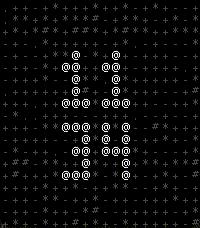

<!-- Generated by scripts/update_app_directory.py: do not edit by hand -->
[← All Pebble Developers](../developers.md)

# Sam

*1 watchface · Last updated 2026-10-12 · [About these lists](../about-app-lists.md)*

Links: [Pebble App Store](https://apps.repebble.com/apps/dev/sam_2c27d574c8b3978fe6d5e34f) · [GitHub (sammo312)](https://github.com/sammo312)

<h2 class="app-name" id="app-e5614fc4168a486b9108c468"><a href="https://apps.repebble.com/e5614fc4168a486b9108c468">ASCII and Ye Shall Receive</a> v2.4.0</h2>
<a class="app-source" href="https://github.com/sammo312/pebble-wf-01" title="Source code" data-search-exclude>View source</a>

Watchface

Released 2026-05-02 Updated 2026-05-03

Runs on: Time 2, Time

Nerd-core ASCII watchface with fun touch interactions. Configurable. WIP

