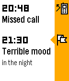
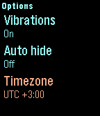
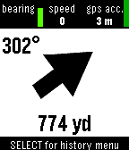
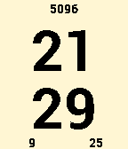
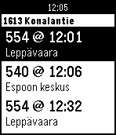
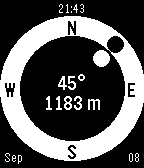
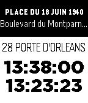
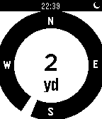

<!-- Generated by scripts/update_app_directory.py: do not edit by hand -->
[← All Pebble Developers](../developers.md)

# Samuel

*2 watchfaces and 12 apps · Last updated 2026-10-12 · [About these lists](../about-app-lists.md)*

Links: [Pebble App Store](https://apps.repebble.com/apps/dev/samuel_52b1f68fcd41831af0000014) · [GitHub (samuelmr)](https://github.com/samuelmr) · [Website (getback.timelinepush.com)](http://getback.timelinepush.com/)

<button type="button" data-filter="all" aria-pressed="true">All 14</button><button type="button" data-filter="watchface" aria-pressed="false">Watchfaces 2</button><button type="button" data-filter="watchapp" aria-pressed="false">Apps 12</button>

<label class="dev-sort">Sort by <select><option value="updated">Recently updated</option><option value="released">Newest release</option><option value="title">A–Z</option></select></label>

<h2 class="app-name" id="app-5552100eec8de733ba00003f"><a href="https://apps.repebble.com/5552100eec8de733ba00003f">Track Mood</a> v2.3</h2>
<a class="app-source" href="https://github.com/samuelmr/pebble-trackmood" title="Source code" data-search-exclude>View source</a>

App

Released 2015-05-12 Updated 2019-07-24

Runs on: Round 2, Time 2, Pebble 2 Duo, Pebble 2, Time Round, Time, Classic

Record your emotional state to your timeline and find happiness! You can rate your mood any time you like. The app will push a corresponding pin to your timeline. You can later browse your…

<h2 class="app-name" id="app-54ae740485dd6760e7000077"><a href="https://apps.repebble.com/54ae740485dd6760e7000077">Hack Portal - Ingress companion</a> v3.18</h2>
<a class="app-source" href="https://github.com/samuelmr/pebble-hackportal" title="Source code" data-search-exclude>View source</a>

App

Released 2015-01-08 Updated 2019-07-24

Runs on: Round 2, Time 2, Pebble 2 Duo, Pebble 2, Time Round, Time, Classic

Reminds you to hack your portals when they cool down. Remembers your hacks and knows when the portals burn down. Configurable Heat Sinks and Multi-hacks. You can configure up to 20 portals. Shows…

<h2 class="app-name" id="app-55243c3fc190e01045000062"><a href="https://apps.repebble.com/55243c3fc190e01045000062">Work Out</a> v1.13</h2>
<a class="app-source" href="https://github.com/samuelmr/pebble-workout" title="Source code" data-search-exclude>View source</a>

App

Released 2015-04-07 Updated 2016-10-28

Runs on: Round 2, Time 2, Pebble 2 Duo, Pebble 2, Time Round, Time, Classic

A work out timer. Work out for 90 seconds, rest for 30 seconds. Repeat. Vibrations every 30 seconds. Customize your own workout routines and times.

<h2 class="app-name" id="app-553329021b2b662f5b000069"><a href="https://apps.repebble.com/553329021b2b662f5b000069">Get Back in Time</a> v3.25</h2>
<a class="app-source" href="https://github.com/samuelmr/pebble-getbackintime" title="Source code" data-search-exclude>View source</a>

App

Released 2015-04-19 Updated 2016-10-28

Runs on: Round 2, Time 2, Pebble 2 Duo, Pebble 2, Time Round, Time, Classic

Save your locations to the Pebble Timeline. See where you have been and when. Choose a location you want to return to. Your Pebble will show you the compass heading and distance. You can push…

<h2 class="app-name" id="app-52ed0fe86ccd08de6200004d"><a href="https://apps.repebble.com/52ed0fe86ccd08de6200004d">Find Watch</a> v1.8</h2>
<a class="app-source" href="https://github.com/samuelmr/pebble-findwatch" title="Source code" data-search-exclude>View source</a>

App

Released 2014-02-01 Updated 2016-10-27

Runs on: Round 2, Time 2, Pebble 2 Duo, Pebble 2, Time Round, Time, Classic

Can&#x27;t find your Pebble? If it is still within bluetooth reach and your phone/pad is connected to your watch, installing this app will make your watch vibrate and flash. The app counts minutes and…

<h2 class="app-name" id="app-52ed4e58e2b7d722a400000a"><a href="https://apps.repebble.com/52ed4e58e2b7d722a400000a">Suunnillee</a> v2.5</h2>
<a class="app-source" href="https://github.com/samuelmr/pebble-suunnillee" title="Source code" data-search-exclude>View source</a>

Watchface

Released 2014-02-01 Updated 2016-10-25

Runs on: Round 2, Time 2, Pebble 2 Duo, Pebble 2, Time Round, Time, Classic

Kellonaika niinku sä ite sen sanoisit. Fuzzy time in Finnish street language.

<h2 class="app-name" id="app-55688648073e045f3e000015"><a href="https://apps.repebble.com/55688648073e045f3e000015">Solve It</a> v2.9</h2>
<a class="app-source" href="https://github.com/samuelmr/pebble-solveit" title="Source code" data-search-exclude>View source</a>

Watchface

Released 2015-05-29 Updated 2016-10-25

Runs on: Round 2, Time 2, Pebble 2 Duo, Pebble 2, Time Round, Time, Classic

See the hours and minutes (optionally also day, month and steps walked today) presented as mathematical expressions. The difficulty level is configurable. Just shake your wrist for solutions.

<h2 class="app-name" id="app-52b1f7b8cd41839a69000015"><a href="https://apps.repebble.com/52b1f7b8cd41839a69000015">Count Down</a> v1.4</h2>
<a class="app-source" href="https://github.com/samuelmr/pebble-countdown" title="Source code" data-search-exclude>View source</a>

App

Released 2013-12-18 Updated 2016-10-25

Runs on: Round 2, Time 2, Pebble 2 Duo, Pebble 2, Time Round, Time, Classic

Customizable timer with vibration notifications at specified times. Giving a talk? Training in the gym? Want to know how time passes without constantly looking at your watch? Let Count Down help!…

<h2 class="app-name" id="app-53ed0a2367c0df00930000ea"><a href="https://apps.repebble.com/53ed0a2367c0df00930000ea">Get Bus - HSL stops</a> v2.4</h2>
<a class="app-source" href="https://github.com/samuelmr/pebble-getbus" title="Source code" data-search-exclude>View source</a>

App

Released 2014-08-14 Updated 2016-10-18

Runs on: Round 2, Time 2, Pebble 2 Duo, Pebble 2, Time Round, Time, Classic

Näe silmäyksellä lähimmät pysäkit ja seuraavat lähdöt. Lisää pysäkkejä suosikkeihin. Tarkastele pysäkkiaikatauluja. Katso kävelyohjeet pysäkille. English summary Find nearest bus stops and…

<h2 class="app-name" id="app-540ca9ef1120350bc20001e0"><a href="https://apps.repebble.com/540ca9ef1120350bc20001e0">Find Cache - geocaching</a> v1.5</h2>
<a class="app-source" href="https://github.com/samuelmr/pebble-findcache" title="Source code" data-search-exclude>View source</a>

App

Released 2014-09-07 Updated 2016-05-23

Runs on: Round 2, Time 2, Pebble 2 Duo, Pebble 2, Time Round, Time, Classic

Geocache companion for Pebble! Configure to set multiple cache locations. Use a simple menu to choose a cache and follow easy directions to find it. Your heading (the white dot) is estimated from…

<h2 class="app-name" id="app-54b3cfebd5587f3596000056"><a href="https://apps.repebble.com/54b3cfebd5587f3596000056">Test Location</a> v1.3</h2>
<a class="app-source" href="https://github.com/samuelmr/pebble-testlocation" title="Source code" data-search-exclude>View source</a>

App

Released 2015-01-12 Updated 2016-05-22

Runs on: Round 2, Time 2, Pebble 2 Duo, Pebble 2, Time Round, Time, Classic

Test location functionality of your Pebble. You can test if your Pebble can get your current location or track your location while you are moving.

<h2 class="app-name" id="app-560c32454bf0ac0115000095"><a href="https://apps.repebble.com/560c32454bf0ac0115000095">Know everything</a> v3.1</h2>
<a class="app-source" href="https://github.com/samuelmr/pebble-knoweverything" title="Source code" data-search-exclude>View source</a>

App

Released 2015-09-30 Updated 2016-05-19

Runs on: Round 2, Time 2, Pebble 2 Duo, Pebble 2, Time Round, Time, Classic

Encyclopedia always at hand. Long press select, speak a term and get the Wikipedia definition to your watch. Get random articles from Wikipedia with a flick of the wrist.

<h2 class="app-name" id="app-54cb8d42cccc995fa900002f"><a href="https://apps.repebble.com/54cb8d42cccc995fa900002f">Public Transit Navigator (beta)</a> v0.1</h2>
<a class="app-source" href="https://github.com/samuelmr/pebble-navitia" title="Source code" data-search-exclude>View source</a>

App

Released 2015-01-30 Updated 2015-02-23

Runs on: Time 2, Pebble 2 Duo, Pebble 2, Time, Classic

Find nearby stops and get route directions to your favorite places. Works in parts of France, Germany, the Netherlands, Spain and the United States. Feedback appreciated!

<h2 class="app-name" id="app-52cae46a6126ce093f000064"><a href="https://apps.repebble.com/52cae46a6126ce093f000064">Get Back - directions to a set location</a> v2.2</h2>
<a class="app-source" href="https://github.com/samuelmr/pebble-getback" title="Source code" data-search-exclude>View source</a>

App

Released 2014-01-06 Updated 2015-02-13

Runs on: Time 2, Pebble 2 Duo, Pebble 2, Time, Classic

This app shows you distance and heading to a stored location. Find your way back from the wilderness - or simply find your parked car! You can also measure distances between two locations…

