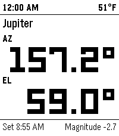

<!-- Generated by scripts/update_app_directory.py: do not edit by hand -->
[← All Pebble Developers](../developers.md)

# Sandor Laboratories

*1 app · Last updated 2026-11-23 · [About these lists](../about-app-lists.md)*

Links: [Pebble App Store](https://apps.repebble.com/apps/dev/sandor-laboratories_7d370006cbdb31721550d79d) · [GitHub (ewsandor)](https://github.com/ewsandor)

<h2 class="app-name" id="app-914097cb3c8d4a5c8a9d198f"><a href="https://apps.repebble.com/914097cb3c8d4a5c8a9d198f">PushTo Tool</a> v0.5.1</h2>
<a class="app-source" href="https://github.com/ewsandor/Pebble-PushTo-Tool" title="Source code" data-search-exclude>View source</a>

App

MIT Released 2026-11-18 Updated 2026-11-22

Runs on: Round 2, Time 2, Pebble 2 Duo, Pebble 2, Time Round, Time

Put a PushTo tool on your wrist for amateur astronomy. PushTo Tool provides live, high-contrast altitude and azimuth readings for locating objects with a Dobsonian telescope or another manual…

