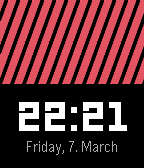

<!-- Generated by scripts/update_app_directory.py: do not edit by hand -->
[← All Pebble Developers](../developers.md)

# Sangelo

*1 watchface · Last updated 2026-10-11 · [About these lists](../about-app-lists.md)*

Links: [Rebble App Store](https://apps.rebble.io/en_US/developer/679cbcc9b7cac900097e0599/1) · [GitHub (SangeloDev)](https://github.com/SangeloDev) · [Website (sangelo.space)](https://sangelo.space)

<h2 class="app-name" id="app-67cb63b7d2acb301fae26e28"><a href="https://apps.rebble.io/en_US/application/67cb63b7d2acb301fae26e28">SimpleStripes</a> v1.0</h2>
<a class="app-source" href="https://github.com/SangeloDev/pebble-simple-stripes" title="Source code" data-search-exclude>View source</a>

Watchface

MIT Released 2025-03-07 Updated 2025-03-07 Rebble App Store

Runs on: Time 2, Time

This watchface has a simple stripe banner at the top and a minimal digital clock with a date at the bottom. Fully configurable and customizable!

