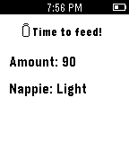

<!-- Generated by scripts/update_app_directory.py: do not edit by hand -->
[← All Pebble Developers](../developers.md)

# santrancisco

*1 app · Last updated 2026-10-11 · [About these lists](../about-app-lists.md)*

Links: [Pebble App Store](https://apps.repebble.com/apps/dev/santrancisco_54ab9f13f3a173dfa500007b) · [GitHub (santrancisco)](https://github.com/santrancisco) · [Website (ebfe.pw)](https://ebfe.pw)

<h2 class="app-name" id="app-54aba1fe8068b7203f00007c"><a href="https://apps.repebble.com/54aba1fe8068b7203f00007c">Milktime</a> v0.9</h2>
<a class="app-source" href="https://github.com/santrancisco/milktime" title="Source code" data-search-exclude>View source</a>

App

Released 2015-01-06 Updated 2015-01-06

Runs on: Time 2, Pebble 2 Duo, Pebble 2, Time, Classic

Milktime is good for mum and dad who have a newborn or an infant. This app alert you the next time your baby has milk, the amount and the potential of soiled nappie base on previous entries…

