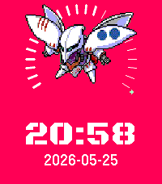
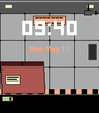
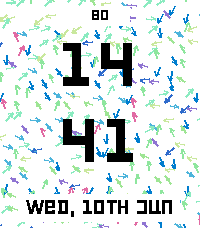

<!-- Generated by scripts/update_app_directory.py: do not edit by hand -->
[← All Pebble Developers](../developers.md)

# Sapphire Second-Hand

*6 watchfaces · Last updated 2026-10-12 · [About these lists](../about-app-lists.md)*

Links: [Pebble App Store](https://apps.repebble.com/apps/dev/sapphire-second-hand_527b6cf8aa4310a44fe95d9d) · [GitHub (shoepaladin)](https://github.com/shoepaladin)

<button type="button" data-filter="all" aria-pressed="true">All 6</button><button type="button" data-filter="watchface" aria-pressed="false">Watchfaces 6</button><button type="button" data-filter="watchapp" aria-pressed="false" disabled>Apps 0</button>

<label class="dev-sort">Sort by <select><option value="updated">Recently updated</option><option value="released">Newest release</option><option value="title">A–Z</option></select></label>

<h2 class="app-name" id="app-db3f6e4f0a904e2894a4b1fa"><a href="https://apps.repebble.com/db3f6e4f0a904e2894a4b1fa">Gundam and Mobile Suit SD Chibi</a> v1.5.0</h2>
<a class="app-source" href="https://github.com/shoepaladin/kiwi-cup/tree/main/pebble/gundam_wfm_static_wf" title="Source code" data-search-exclude>View source</a>

Watchface

Released 2026-05-26 Updated 2026-10-11

Runs on: Round 2, Time 2, Time Round

Track time and step counts with Gundam Aerial, Calibarn, GPO2A, Qubeley, Xi, Byarlant, Zeta, Sazabi, and Crossbone. Steps are represented with filling in an arc of vertical lines. When battery is…

<h2 class="app-name" id="app-59e198bbfd404eb58da8994f"><a href="https://apps.repebble.com/59e198bbfd404eb58da8994f">Tactics Ogre Watchface</a> v1.5.4</h2>
<a class="app-source" href="https://github.com/shoepaladin/kiwi-cup/tree/main/pebble/tactics_ogre_classes_wf" title="Source code" data-search-exclude>View source</a>

Watchface

Released 2026-05-13 Updated 2026-08-14

Runs on: Round 2, Time 2, Time Round, Time

Your favorite Tactics Ogre classes watch you track your time, steps, temperature, battery, weather, heart rate, and more! Currently Supported: *Classes*: Archer, Barbarian, Cleric, Knight, Rune…

<h2 class="app-name" id="app-de5b5b388f8b4adea2857f14"><a href="https://apps.repebble.com/de5b5b388f8b4adea2857f14">Metal Gear Cardboard Box Watchface</a> v1.15</h2>
<a class="app-source" href="https://github.com/shoepaladin/kiwi-cup/tree/main/pebble/metalgear_cbox_wf" title="Source code" data-search-exclude>View source</a>

Watchface

Released 2026-05-06 Updated 2026-06-25

Runs on: Round 2, Time 2, Pebble 2 Duo, Pebble 2, Time Round, Time

See Snake sneak across your watch! Featuring a Shadow Moses inspired dark mode. When BT disconnects, see &quot;FISSION MAILED&quot; displayed across the screen. Different selectable cardboard boxes.

<h2 class="app-name" id="app-3ee5889ee7764faaac9a5476"><a href="https://apps.repebble.com/3ee5889ee7764faaac9a5476">perlin forked v2</a> v1.5.1</h2>
<a class="app-source" href="https://github.com/shoepaladin/pebbleface-perlin" title="Source code" data-search-exclude>View source</a>

Watchface

Released 2026-06-10 Updated 2026-06-11

Runs on: Round 2, Time 2, Time Round, Time

This is a fork of the original Perlin watchface (https://apps.repebble.com/55aa599e27eb8dd245000090?section=watchfaces). You can configure: 1. Date 2. Battery percentage at the top 3. Steps…

<h2 class="app-name" id="app-ab47d1d5bb7d4ef0ba968d1d"><a href="https://apps.repebble.com/ab47d1d5bb7d4ef0ba968d1d">Horizon Forbidden West Machines</a> v1.1.5</h2>
<a class="app-source" href="https://github.com/shoepaladin/kiwi-cup/tree/main/pebble/hzd-machines-wf" title="Source code" data-search-exclude>View source</a>

Watchface

Released 2026-06-06 Updated 2026-06-10

Runs on: Time 2, Pebble 2 Duo, Pebble 2, Time

Track the time, your steps, and battery with a machine from Horizon Forbidden West. The arrow grows as you take more steps, and the circles track battery. When Bluetooth disconnects, the colors…

<h2 class="app-name" id="app-f117fb3ec20e45f3b03781a2"><a href="https://apps.repebble.com/f117fb3ec20e45f3b03781a2">Nausicaa Glider</a> v1.0.45</h2>
<a class="app-source" href="https://github.com/shoepaladin/kiwi-cup/tree/main/pebble/nausicaa-glider-m-wf" title="Source code" data-search-exclude>View source</a>

Watchface

Released 2026-05-17 Updated 2026-05-19

Runs on: Round 2, Time 2, Pebble 2 Duo, Pebble 2, Time Round

Track the time, weather, steps, and battery with Nausicaa. Colors invert when BT disconnects. Image credit to Umineko97: https://www.deviantart.com/umineko97/gallery

