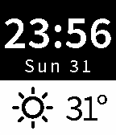

<!-- Generated by scripts/update_app_directory.py: do not edit by hand -->
[← All Pebble Developers](../developers.md)

# Sasmito Adibowo

*1 watchface · Last updated 2026-10-11 · [About these lists](../about-app-lists.md)*

Links: [Pebble App Store](https://apps.repebble.com/apps/dev/sasmito-adibowo_552e721e26541f24e8000019) · [GitHub (adib)](https://github.com/adib) · [Website (basilsalad.com)](http://basilsalad.com/kitchen/futura-weather-improved/)

<h2 class="app-name" id="app-556a866c4bebd0425500009a"><a href="https://apps.repebble.com/556a866c4bebd0425500009a">Source Sans Pro Weather</a> v2.2</h2>
<a class="app-source" href="https://github.com/adib/futura-weather-sdk2.0/tree/font/source-sans-pro" title="Source code" data-search-exclude>View source</a>

Watchface

No licence Released 2015-05-31 Updated 2015-06-01

Runs on: Time 2, Pebble 2 Duo, Pebble 2, Time, Classic

Current weather with day of week and date in Adobe&#x27;s Source Sans Pro. Updates the weather every 15 minutes and you can flick your wrist to force the update if there&#x27;s a connection issue. Source…

