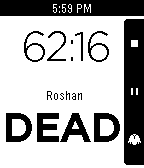

<!-- Generated by scripts/update_app_directory.py: do not edit by hand -->
[← All Pebble Developers](../developers.md)

# Satragno Software

*1 app · Last updated 2026-10-12 · [About these lists](../about-app-lists.md)*

Links: [Pebble App Store](https://apps.repebble.com/apps/dev/satragno-software_53a73e0a574522633400001a) · [GitHub (nicolassatragno)](https://github.com/nicolassatragno) · [Website (satragno.com)](http://satragno.com/dota2timer.html)

<h2 class="app-name" id="app-53efb1efbb2f684ce7000169"><a href="https://apps.repebble.com/53efb1efbb2f684ce7000169">Dota2Timer</a> v1.0</h2>
<a class="app-source" href="https://github.com/nicolassatragno/dota2timer" title="Source code" data-search-exclude>View source</a>

App

Released 2014-08-16 Updated 2014-08-23

Runs on: Time 2, Pebble 2 Duo, Pebble 2, Time, Classic

A timer app for DOTA2. Features: Roshan status - Press a button when Rosh is killed, and you&#x27;ll get a display of its status (dead or alive) or the chances of it having respawned. Optional…

