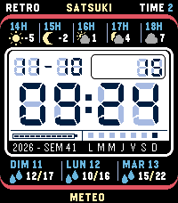

<!-- Generated by scripts/update_app_directory.py: do not edit by hand -->
[← All Pebble Developers](../developers.md)

# Satsuki Yatoshi

*1 watchface · Last updated 2026-10-12 · [About these lists](../about-app-lists.md)*

Links: [Pebble App Store](https://apps.repebble.com/apps/dev/satsuki-yatoshi_3122802131eab586ec96c927) · [GitHub (satsukiyatoshi)](https://github.com/satsukiyatoshi)

<h2 class="app-name" id="app-0deee14e32e54453a975067f"><a href="https://apps.repebble.com/0deee14e32e54453a975067f">Satsuki Retro LCD Meteo</a> v1.2.2</h2>
<a class="app-source" href="https://github.com/satsukiyatoshi/Peeble-time-2-Satsuki-Retro-LCD-Meteo" title="Source code" data-search-exclude>View source</a>

Watchface

Released 2026-10-08 Updated 2026-10-11

Runs on: Time 2

Inspiration and project origins The design of Satsuki Retro LCD Meteo is notably inspired by Quartz by Dalpek, a retro LCD watchface for the Pebble Time 2…

