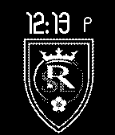
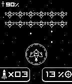

<!-- Generated by scripts/update_app_directory.py: do not edit by hand -->
[← All Pebble Developers](../developers.md)

# Sawyer Pangborn

*3 watchfaces · Last updated 2026-10-12 · [About these lists](../about-app-lists.md)*

Links: [Rebble App Store](https://apps.rebble.io/en_US/developer/529a3a33129af7f5b00000cc/1) · [Pebble App Store](https://apps.repebble.com/apps/dev/sawyer-pangborn_529a3a33129af7f5b00000cc) · [GitHub (spangborn)](https://github.com/spangborn) · [Website (anesti.org)](http://anesti.org)

<button type="button" data-filter="all" aria-pressed="true">All 3</button><button type="button" data-filter="watchface" aria-pressed="false">Watchfaces 3</button><button type="button" data-filter="watchapp" aria-pressed="false" disabled>Apps 0</button>

<label class="dev-sort">Sort by <select><option value="updated">Recently updated</option><option value="released">Newest release</option><option value="title">A–Z</option></select></label>

<a class="app-shot" href="https://apps.rebble.io/en_US/application/5351c91c27e150b0b300003a" data-search-exclude>No screenshot</a>

<h2 class="app-name" id="app-5351c91c27e150b0b300003a"><a href="https://apps.rebble.io/en_US/application/5351c91c27e150b0b300003a">N88KA</a> v1.1.0</h2>
<a class="app-source" href="http://github.com/spangborn/pebble-n8" title="Source code" data-search-exclude>View source</a>

Watchface

No licence Released 2014-04-19 Updated 2025-12-01 Rebble App Store

Runs on: Time 2, Pebble 2 Duo, Pebble 2, Time, Classic

N88KA watchface.

<h2 class="app-name" id="app-54ecccffd9c53be7db0000ad"><a href="https://apps.repebble.com/54ecccffd9c53be7db0000ad">Real Salt Lake</a> v2.0</h2>
<a class="app-source" href="http://github.com/spangborn/pebble-realsaltlake" title="Source code" data-search-exclude>View source</a>

Watchface

No licence Released 2015-02-24 Updated 2015-02-24

Runs on: Time 2, Pebble 2 Duo, Pebble 2, Time, Classic

Are you RSLTID? Then you need the Real Salt Lake watchface

<h2 class="app-name" id="app-529a42d7e627cec9a0000116"><a href="https://apps.repebble.com/529a42d7e627cec9a0000116">Space Time</a> v1.1.0</h2>
<a class="app-source" href="http://github.com/spangborn/pebble-space-time/" title="Source code" data-search-exclude>View source</a>

Watchface

No licence Released 2013-11-30 Updated 2013-11-30

Runs on: Time 2, Pebble 2 Duo, Pebble 2, Time, Classic

A Space-Invaders style watchface. Credit to &quot;Rhys Davies&quot; for the original idea / artwork. Character in the top left indicates bluetooth connectivity. If he goes away, you&#x27;ve lost connection. The…

