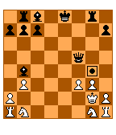

<!-- Generated by scripts/update_app_directory.py: do not edit by hand -->
[← All Pebble Developers](../developers.md)

# Sawyer Vaughan

*2 apps · Last updated 2026-10-11 · [About these lists](../about-app-lists.md)*

Links: [Pebble App Store](https://apps.repebble.com/apps/dev/sawyer-vaughan_54a3bb34f10f42fe71000065) · [GitHub (runnersaw)](https://github.com/runnersaw)

<button type="button" data-filter="all" aria-pressed="true">All 2</button><button type="button" data-filter="watchface" aria-pressed="false" disabled>Watchfaces 0</button><button type="button" data-filter="watchapp" aria-pressed="false">Apps 2</button>

<label class="dev-sort">Sort by <select><option value="updated">Recently updated</option><option value="released">Newest release</option><option value="title">A–Z</option></select></label>

<h2 class="app-name" id="app-54f65e8a13cdff61490000b6"><a href="https://apps.repebble.com/54f65e8a13cdff61490000b6">Games for Pebble</a> v6.2</h2>
<a class="app-source" href="https://github.com/runnersaw/pebble-games" title="Source code" data-search-exclude>View source</a>

App

Released 2015-03-04 Updated 2016-10-29

Runs on: Round 2, Time 2, Pebble 2 Duo, Pebble 2, Time Round, Time, Classic

The best games app for Pebble! A collection of addicting games to waste a few minutes whenever you need to.

<h2 class="app-name" id="app-56940424ead187610700004f"><a href="https://apps.repebble.com/56940424ead187610700004f">Chess for Pebble</a> v1.0</h2>
<a class="app-source" href="https://github.com/runnersaw/pebble-chess" title="Source code" data-search-exclude>View source</a>

App

Released 2016-01-11 Updated 2016-01-11

Runs on: Time 2, Pebble 2 Duo, Pebble 2, Time, Classic

Welcome to Chess for Pebble! Play against a chess AI with varying levels of difficulty. This game used to be a part of Games for Pebble, but was removed on Aplite due to memory restrictions.

