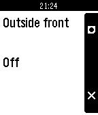

<!-- Generated by scripts/update_app_directory.py: do not edit by hand -->
[← All Pebble Developers](../developers.md)

# Scardiecat

*1 app · Last updated 2026-10-12 · [About these lists](../about-app-lists.md)*

Links: [Pebble App Store](https://apps.repebble.com/apps/dev/scardiecat_52f031baa0cb6aa635000af1)

<h2 class="app-name" id="app-530bf25cd3b64223fa000059"><a href="https://apps.repebble.com/530bf25cd3b64223fa000059">Gogomba</a> v1.1</h2>
<a class="app-source" href="https://bitbucket.org/magicmoose/gogomba/" title="Source code" data-search-exclude>View source</a>

App

Released 2014-02-25 Updated 2017-03-04

Runs on: Time 2, Pebble 2 Duo, Pebble 2, Time, Classic

Remotely control you home from you Pebble. Communicates with your ISY-994i controller to control scenes and devices.

