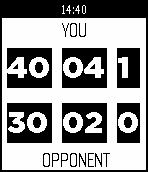

<!-- Generated by scripts/update_app_directory.py: do not edit by hand -->
[← All Pebble Developers](../developers.md)

# Scott D

*1 app · Last updated 2026-10-11 · [About these lists](../about-app-lists.md)*

Links: [Pebble App Store](https://apps.repebble.com/apps/dev/scott-d_558413a50a225dd5f50000a6) · [GitHub (scottyblizz)](https://github.com/scottyblizz)

<h2 class="app-name" id="app-5584198e5160209a4600009c"><a href="https://apps.repebble.com/5584198e5160209a4600009c">Simple Tennis Scorer</a> v1.0</h2>
<a class="app-source" href="https://github.com/scottyblizz/TennisScorer" title="Source code" data-search-exclude>View source</a>

App

Released 2015-06-19 Updated 2015-06-19

Runs on: Time 2, Pebble 2 Duo, Pebble 2, Time, Classic

Tennis scoring app. Useful for forgetful veterans or beginners unsure on the rules. Press UP or DOWN every time someone scores a point. Press SELECT to reset the scores.

