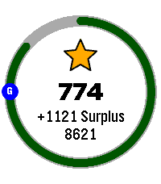

<!-- Generated by scripts/update_app_directory.py: do not edit by hand -->
[← All Pebble Developers](../developers.md)

# Scott Hacker

*1 app · Last updated 2026-10-12 · [About these lists](../about-app-lists.md)*

Links: [Pebble App Store](https://apps.repebble.com/apps/dev/scott-hacker_d1afe4ba70cf58368a1f209d) · [GitHub (Shacker10)](https://github.com/Shacker10)

<h2 class="app-name" id="app-b8ed8bf41c0142dfbd4fe9c5"><a href="https://apps.repebble.com/b8ed8bf41c0142dfbd4fe9c5">Hourly Steps</a> v1.0.0</h2>
<a class="app-source" href="https://github.com/Shacker10/Hourly-Steps" title="Source code" data-search-exclude>View source</a>

App

MIT Released 2026-07-22 Updated 2026-07-22

Runs on: Round 2, Time 2

Hourly Steps mimics Fitbit&#x27;s &quot;Reminder to Move&quot; functionality but with way more user control. Through App settings you can adjust: - What hour to start getting reminders - How many minutes before…

