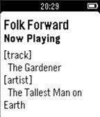

<!-- Generated by scripts/update_app_directory.py: do not edit by hand -->
[← All Pebble Developers](../developers.md)

# scott kosman

*1 app · Last updated 2026-10-11 · [About these lists](../about-app-lists.md)*

Links: [Pebble App Store](https://apps.repebble.com/apps/dev/scott-kosman_559eedd5e2b45afe44000070) · [GitHub (humantorch)](https://github.com/humantorch) · [Website (somafm.com)](http://somafm.com)

<h2 class="app-name" id="app-55a7f76374e429d266000040"><a href="https://apps.repebble.com/55a7f76374e429d266000040">SomaFM – Now Playing</a> v1.0</h2>
<a class="app-source" href="https://github.com/humantorch/pebble-somafm" title="Source code" data-search-exclude>View source</a>

App

Released 2015-07-16 Updated 2015-07-16

Runs on: Time 2, Pebble 2 Duo, Pebble 2, Time, Classic

Listen to SomaFM (http://somafm.com) streaming radio on the go? Now you can easily get the artist and title of the currently-playing track on any SomaFM station without digging your phone out of…

