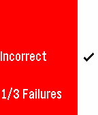

<!-- Generated by scripts/update_app_directory.py: do not edit by hand -->
[← All Pebble Developers](../developers.md)

# Sean Dougher

*1 app · Last updated 2026-10-11 · [About these lists](../about-app-lists.md)*

Links: [Pebble App Store](https://apps.repebble.com/apps/dev/sean-dougher_540663c3edb9187595000006) · [GitHub (SeanmanX)](https://github.com/SeanmanX) · [Website (devpost.com)](http://devpost.com/software/hackingedu-project)

<h2 class="app-name" id="app-562c76d2b56e5d23d8000057"><a href="https://apps.repebble.com/562c76d2b56e5d23d8000057">DailEQs</a> v1.0</h2>
<a class="app-source" href="https://github.com/SeanmanX/hackingEDU-project" title="Source code" data-search-exclude>View source</a>

App

No licence Released 2015-10-25 Updated 2015-10-25

Runs on: Time 2, Pebble 2 Duo, Pebble 2, Time, Classic

DailEQs is a Pebble math game that helps users increase their mental agility. Practice your arithmetic conveniently and on the go with these daily equations. This app was built at HackingEDU 2015…

