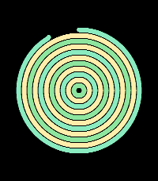

<!-- Generated by scripts/update_app_directory.py: do not edit by hand -->
[← All Pebble Developers](../developers.md)

# Sean Rice

*1 watchface · Last updated 2026-10-11 · [About these lists](../about-app-lists.md)*

Links: [Rebble App Store](https://apps.rebble.io/en_US/developer/584a2ecf77324b357a0000ff/1) · [GitHub (seanriceaz)](https://github.com/seanriceaz)

<h2 class="app-name" id="app-58707c952ee43116390005ac"><a href="https://apps.rebble.io/en_US/application/58707c952ee43116390005ac">Rings by Sean Rice</a> v1.0</h2>
<a class="app-source" href="https://github.com/seanriceaz/pebble-rings" title="Source code" data-search-exclude>View source</a>

Watchface

Released 2017-01-07 Updated 2017-01-07 Rebble App Store

Runs on: Round 2, Time 2, Pebble 2 Duo, Pebble 2, Time Round, Time

Inspired by tree rings, this configurable watch face traces one concentric circle per hour. Change colors, line thickness, and starting point (outside or inside) from the settings screen.

