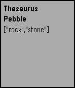

<!-- Generated by scripts/update_app_directory.py: do not edit by hand -->
[← All Pebble Developers](../developers.md)

# Sean Sullivan

*1 app · Last updated 2026-10-12 · [About these lists](../about-app-lists.md)*

Links: [Pebble App Store](https://apps.repebble.com/apps/dev/sean-sullivan_56423f08c86aba05fd00006e) · [GitHub (seanthesheep)](https://github.com/seanthesheep) · [Website (seansullivan.ninja)](http://www.seansullivan.ninja)

<h2 class="app-name" id="app-574cf5286037e8af36000013"><a href="https://apps.repebble.com/574cf5286037e8af36000013">Thesaurus</a> v1.0</h2>
<a class="app-source" href="https://github.com/seanthesheep/PebbleThesaurus" title="Source code" data-search-exclude>View source</a>

App

Released 2016-05-31 Updated 2016-05-31

Runs on: Time 2, Time

Very simple voice-dictated thesaurus using the Big Huge Thesaurus API.

