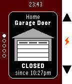
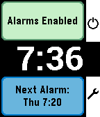

<!-- Generated by scripts/update_app_directory.py: do not edit by hand -->
[← All Pebble Developers](../developers.md)

# SeaPea Software

*1 watchface and 3 apps · Last updated 2026-10-12 · [About these lists](../about-app-lists.md)*

Links: [Pebble App Store](https://apps.repebble.com/apps/dev/seapea-software_52f00ed07a772ced5d0000db) · [GitHub (SeaPea)](https://github.com/SeaPea)

<button type="button" data-filter="all" aria-pressed="true">All 4</button><button type="button" data-filter="watchface" aria-pressed="false">Watchfaces 1</button><button type="button" data-filter="watchapp" aria-pressed="false">Apps 3</button>

<label class="dev-sort">Sort by <select><option value="updated">Recently updated</option><option value="released">Newest release</option><option value="title">A–Z</option></select></label>

<h2 class="app-name" id="app-553723fe1fa0b37b9800002f"><a href="https://apps.repebble.com/553723fe1fa0b37b9800002f">HomeP - For MyQ Garage Doors &amp; Light Switches</a> v2.2</h2>
<a class="app-source" href="https://github.com/SeaPea/HomeP" title="Source code" data-search-exclude>View source</a>

App

MIT Released 2015-04-22 Updated 2017-02-23

Runs on: Round 2, Time 2, Pebble 2 Duo, Pebble 2, Time Round, Time, Classic

Unofficial watch app for monitoring and operating Chamberlain/Liftmaster branded MyQ devices over the Internet (Requires MyQ Internet Gateway, usually sold separately) , now including the &quot;MyQ…

<h2 class="app-name" id="app-546047390db50db6e100002b"><a href="https://apps.repebble.com/546047390db50db6e100002b">Gentle Wake (Daily Smart Alarm Clock with Sleep Monitoring)</a> v3.2</h2>
<a class="app-source" href="https://github.com/SeaPea/GentleWake" title="Source code" data-search-exclude>View source</a>

App

MIT Released 2014-11-10 Updated 2016-10-08

Runs on: Round 2, Time 2, Pebble 2 Duo, Pebble 2, Time Round, Time, Classic

- Alarms for each day of the week - Smart Alarm attempts to wake you if it detects you stirring shortly before the alarm time, which is the Monitor Period (doesn&#x27;t interfere with background…

<h2 class="app-name" id="app-5361706f17c60e02d800020e"><a href="https://apps.repebble.com/5361706f17c60e02d800020e">ForeCal (Weather Forecast &amp; Calendar)</a> v4.0</h2>
<a class="app-source" href="https://github.com/SeaPea/ForeCal" title="Source code" data-search-exclude>View source</a>

Watchface

MIT Released 2014-04-30 Updated 2016-10-08

Runs on: Round 2, Time 2, Pebble 2 Duo, Pebble 2, Time Round, Time, Classic

Displays today&#x27;s/tomorrow&#x27;s forecast with a 3 week calendar always on screen. (No need to flick wrist or tap to get to another view) Now with color! - Current details: Time, date, Battery…

<h2 class="app-name" id="app-54ade8cfbd2d5ce85e000014"><a href="https://apps.repebble.com/54ade8cfbd2d5ce85e000014">Draw - Sketch on your Wrist!</a> v0.5</h2>
<a class="app-source" href="https://github.com/SeaPea/Draw" title="Source code" data-search-exclude>View source</a>

App

GPL-2.0 Released 2015-01-08 Updated 2015-03-01

Runs on: Time 2, Pebble 2 Duo, Pebble 2, Time, Classic

Draw just by tilting your wrist! Note: Currently not compatible with Pebble Times. Working on fixing this and adding color. Send the drawing to your phone without sending anything to a server or…

