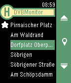

<!-- Generated by scripts/update_app_directory.py: do not edit by hand -->
[← All Pebble Developers](../developers.md)

# Sebastian Schneider

*1 app · Last updated 2026-10-11 · [About these lists](../about-app-lists.md)*

Links: [Pebble App Store](https://apps.repebble.com/apps/dev/sebastian-schneider_560e0d585495b946af00007c) · [GitHub (eadi)](https://github.com/eadi)

<h2 class="app-name" id="app-568fc0da40353fbb78000051"><a href="https://apps.repebble.com/568fc0da40353fbb78000051">DVBMonitor</a> v2.1</h2>
<a class="app-source" href="https://github.com/eadi/dvbmonitor" title="Source code" data-search-exclude>View source</a>

App

Released 2016-01-08 Updated 2016-03-31

Runs on: Time 2, Pebble 2 Duo, Pebble 2, Time, Classic

Supports English and German. Lists the next departures on the closest DVB station (Dresden area). Mark stations as favorites to select them or other nearby stations later. Deutsch Zeigt die…

