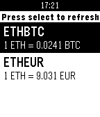

<!-- Generated by scripts/update_app_directory.py: do not edit by hand -->
[← All Pebble Developers](../developers.md)

# Sebastien Castiel

*1 app · Last updated 2026-10-11 · [About these lists](../about-app-lists.md)*

Links: [Pebble App Store](https://apps.repebble.com/apps/dev/sebastien-castiel_56a6855eed368bf53c00004d) · [GitHub (scastiel)](https://github.com/scastiel)

<h2 class="app-name" id="app-56df00cb68994ff0f9000012"><a href="https://apps.repebble.com/56df00cb68994ff0f9000012">Ethicker</a> v1.1</h2>
<a class="app-source" href="https://github.com/scastiel/pebethicker" title="Source code" data-search-exclude>View source</a>

App

Released 2016-03-08 Updated 2016-03-10

Runs on: Time 2, Pebble 2 Duo, Pebble 2, Time, Classic

Easily get current Ether or Bitcoin value on your watch! Supported tickers: BTCEUR, BTCHKD, BTCUSD, ETHBTC, ETHEUR, ETHUSD, REPBTC. Data is fetched from Gatecoin public API. Please note that since…

