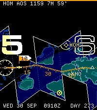
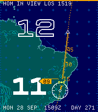
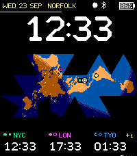

<!-- Generated by scripts/update_app_directory.py: do not edit by hand -->
[← All Pebble Developers](../developers.md)

# Segfaultgolf

*3 watchfaces · Last updated 2026-10-11 · [About these lists](../about-app-lists.md)*

Links: [Pebble App Store](https://apps.repebble.com/apps/dev/segfaultgolf_7b8611af506d76669d94d52b) · [GitHub (huntrontrakkr)](https://github.com/huntrontrakkr) · [Website (huntrontrakkr.github.io)](https://huntrontrakkr.github.io/dymaxion-watch-face/)

<button type="button" data-filter="all" aria-pressed="true">All 3</button><button type="button" data-filter="watchface" aria-pressed="false">Watchfaces 3</button><button type="button" data-filter="watchapp" aria-pressed="false" disabled>Apps 0</button>

<label class="dev-sort">Sort by <select><option value="updated">Recently updated</option><option value="released">Newest release</option><option value="title">A–Z</option></select></label>

<h2 class="app-name" id="app-7e96e11b99aa4f6fb3ba3928"><a href="https://apps.repebble.com/7e96e11b99aa4f6fb3ba3928">Groundtrack Fuller</a> v0.6.3</h2>
<a class="app-source" href="https://github.com/huntrontrakkr/groundtrack-watch-face" title="Source code" data-search-exclude>View source</a>

Watchface

Released 2026-10-02 Updated 2026-10-08

Runs on: Time 2

Groundtrack Fuller draws where the Sun, the Moon or a satellite is over the Earth, and where it goes next, on Buckminster Fuller&#x27;s unfolded globe with the time set along the route. One face. The…

<h2 class="app-name" id="app-4cb497d2805d4b0b87d70876"><a href="https://apps.repebble.com/4cb497d2805d4b0b87d70876">Groundtrack</a> v0.6.3</h2>
<a class="app-source" href="https://github.com/huntrontrakkr/groundtrack-watch-face" title="Source code" data-search-exclude>View source</a>

Watchface

Released 2026-10-02 Updated 2026-10-08

Runs on: Time 2

Groundtrack draws where the Sun, the Moon or a satellite is over the Earth, and where it goes next, on a flat chart with the time set along the route. Two faces in one. Enroute is an hour chart…

<h2 class="app-name" id="app-6d7f75de20c3406198a5abd6"><a href="https://apps.repebble.com/6d7f75de20c3406198a5abd6">Dymaxion</a> v0.9.0</h2>
<a class="app-source" href="https://github.com/huntrontrakkr/dymaxion-watch-face" title="Source code" data-search-exclude>View source</a>

Watchface

Released 2026-09-25 Updated 2026-10-07

Runs on: Time 2

A watch face built on Buckminster Fuller&#x27;s Dymaxion map, which unfolds the globe onto the twenty faces of an icosahedron without splitting a continent. Fuller called it a deck plan of Spaceship…

