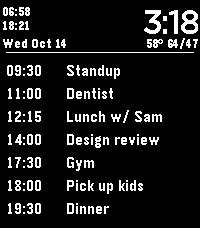

<!-- Generated by scripts/update_app_directory.py: do not edit by hand -->
[← All Pebble Developers](../developers.md)

# selbereth

*1 watchface · Last updated 2026-11-02 · [About these lists](../about-app-lists.md)*

Links: [Pebble App Store](https://apps.repebble.com/apps/dev/selbereth_7d9d408100aab8892fcd8324)

<h2 class="app-name" id="app-3a526a9d21df4b86b8e7be18"><a href="https://apps.repebble.com/3a526a9d21df4b86b8e7be18">Calendar Face</a> v1.0.0</h2>
<a class="app-source" href="https://github.com-selbereth/selbereth/calendar-pebble-watchface" title="Source code" data-search-exclude>View source</a>

Watchface

Released 2026-10-14 Updated 2026-10-14

Runs on: Round 2, Time 2, Pebble 2 Duo, Pebble 2, Time Round, Time, Classic

Your calendar, on your watch face. Calendar lists your next appointments, with their start times, right under the clock, as many as fit your screen. Events come from the calendars already synced…

