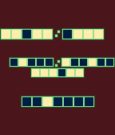
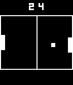

<!-- Generated by scripts/update_app_directory.py: do not edit by hand -->
[← All Pebble Developers](../developers.md)

# semiprocoder

*1 watchface and 1 app · Last updated 2026-10-11 · [About these lists](../about-app-lists.md)*

Links: [Pebble App Store](https://apps.repebble.com/apps/dev/semiprocoder_57a39f911482cd2d6e000247) · [GitHub (awesommee333)](https://github.com/awesommee333) · [Website (andrewkrapivin.xyz)](http://andrewkrapivin.xyz)

<button type="button" data-filter="all" aria-pressed="true">All 2</button><button type="button" data-filter="watchface" aria-pressed="false">Watchfaces 1</button><button type="button" data-filter="watchapp" aria-pressed="false">Apps 1</button>

<label class="dev-sort">Sort by <select><option value="updated">Recently updated</option><option value="released">Newest release</option><option value="title">A–Z</option></select></label>

<h2 class="app-name" id="app-57c234f75e3c3d0bfc000266"><a href="https://apps.repebble.com/57c234f75e3c3d0bfc000266">Binary Watch</a> v1.0</h2>
<a class="app-source" href="https://github.com/awesommee333/BinaryWatch" title="Source code" data-search-exclude>View source</a>

Watchface

GPL-3.0 Released 2016-08-28 Updated 2016-08-28

Runs on: Round 2, Time 2, Pebble 2 Duo, Pebble 2, Time Round, Time, Classic

This watchface is a fully functional binary clock. Each row of blocks represent a binary number, with (currently)blue signifying a zero and yellow signifying a one. The center shows the…

<h2 class="app-name" id="app-57a77b4022f5994a8f000af7"><a href="https://apps.repebble.com/57a77b4022f5994a8f000af7">Pong Classic</a> v1.0</h2>
<a class="app-source" href="https://github.com/awesommee333/Pebble-Pong" title="Source code" data-search-exclude>View source</a>

App

GPL-3.0 Released 2016-08-07 Updated 2016-08-07

Runs on: Time 2, Pebble 2 Duo, Pebble 2, Time, Classic

This is a basic pong game for the pebble. It features a relatively simple ai. You keep playing forever, with no winning. Just see how high of a score you can get relative to the ai. Help me out by…

