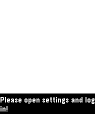

<!-- Generated by scripts/update_app_directory.py: do not edit by hand -->
[← All Pebble Developers](../developers.md)

# Semyon Maryasin

*1 app · Last updated 2026-10-12 · [About these lists](../about-app-lists.md)*

Links: [Pebble App Store](https://apps.repebble.com/apps/dev/semyon-maryasin_52b1f151cd41832b4000000c) · [GitHub (MarSoft)](https://github.com/MarSoft) · [Website (forums.getpebble.com)](http://forums.getpebble.com/discussion/9564/watchapp-pebblenotes-a-google-tasks-client-free-opensource/p1)

<h2 class="app-name" id="app-52b1fc07cd41830cc200001e"><a href="https://apps.repebble.com/52b1fc07cd41830cc200001e">GoogleTasks for Pebble</a> v1.14</h2>
<a class="app-source" href="http://github.com/MarSoft/PebbleNotes" title="Source code" data-search-exclude>View source</a>

App

MIT Released 2013-12-18 Updated 2026-04-30

Runs on: Round 2, Time 2, Pebble 2 Duo, Pebble 2, Time Round, Time, Classic

Browse all your ToDo lists (from GoogleTasks) right on your wrist! Task notes are supported too. You can also mark tasks as Done. You will no longer need to look at your phone while buying…

