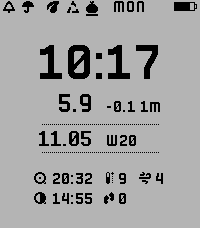

<!-- Generated by scripts/update_app_directory.py: do not edit by hand -->
[← All Pebble Developers](../developers.md)

# Sergei Likharev

*1 watchface · Last updated 2026-10-11 · [About these lists](../about-app-lists.md)*

Links: [Pebble App Store](https://apps.repebble.com/apps/dev/sergei-likharev_6d5f94cbf98c1a1627ff2fab) · [GitHub (mollyjester)](https://github.com/mollyjester)

<h2 class="app-name" id="app-bfecfeaed9de40ef9d929b66"><a href="https://apps.repebble.com/bfecfeaed9de40ef9d929b66">Rat Scout</a> v1.8.0</h2>
<a class="app-source" href="https://github.com/mollyjester/rat_scout" title="Source code" data-search-exclude>View source</a>

Watchface · <a href="https://forum.rebble.io/t/665" title="Discuss this app on the Rebble forum" data-search-exclude>Forum thread</a>

Released 2026-05-11 Updated 2026-05-11

Runs on: Time 2, Pebble 2 Duo

A Pebble watchface that displays real-time Dexcom CGM blood glucose readings alongside weather, astronomy, step count, and garbage collection schedule — with configurable vibration and sound…

