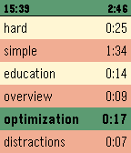

<!-- Generated by scripts/update_app_directory.py: do not edit by hand -->
[← All Pebble Developers](../developers.md)

# Sergey Kotsur

*1 app · Last updated 2026-10-12 · [About these lists](../about-app-lists.md)*

Links: [Rebble App Store](https://apps.rebble.io/en_US/developer/5601715225a99dbfe7000074/1) · [GitHub (joker512)](https://github.com/joker512)

<h2 class="app-name" id="app-585d44f85de850e8dc000629"><a href="https://apps.rebble.io/en_US/application/585d44f85de850e8dc000629">Time Tracker</a> v1.6</h2>
<a class="app-source" href="https://github.com/joker512/pebble_tracker" title="Source code" data-search-exclude>View source</a>

App

GPL-3.0 Released 2016-12-23 Updated 2017-09-22 Rebble App Store

Runs on: Time 2, Time

There is no good time tracking apps for Pebble, you know. I hope this one would close the gap. Read the full documentation here: https://github.com/joker512/pebble_tracker/blob/master/README.md

