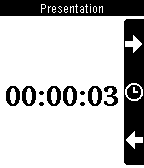

<!-- Generated by scripts/update_app_directory.py: do not edit by hand -->
[← All Pebble Developers](../developers.md)

# Sergio Araki

*1 app · Last updated 2026-10-12 · [About these lists](../about-app-lists.md)*

Links: [Pebble App Store](https://apps.repebble.com/apps/dev/sergio-araki_52b1e53cc8363de035000007) · [GitHub (sergioaraki)](https://github.com/sergioaraki)

<h2 class="app-name" id="app-52ebbc927d49761086000033"><a href="https://apps.repebble.com/52ebbc927d49761086000033">Remote Presentations</a> v1.2</h2>
<a class="app-source" href="https://github.com/sergioaraki/RemotePresentations" title="Source code" data-search-exclude>View source</a>

App

Released 2014-01-31 Updated 2014-11-02

Runs on: Time 2, Pebble 2 Duo, Pebble 2, Time, Classic

Controls HTML5 presentations from your wrist. You will need a computer running the server side, follow instructions from: https://github.com/sergioaraki/RemotePresentations

