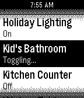

<!-- Generated by scripts/update_app_directory.py: do not edit by hand -->
[← All Pebble Developers](../developers.md)

# Seth Goldman

*1 app · Last updated 2026-10-12 · [About these lists](../about-app-lists.md)*

Links: [Pebble App Store](https://apps.repebble.com/apps/dev/seth-goldman_52f02429af0eabd57c0006f9) · [GitHub (srgoldman)](https://github.com/srgoldman)

<h2 class="app-name" id="app-5541773725cbe39ea900000f"><a href="https://apps.repebble.com/5541773725cbe39ea900000f">Indigo Remote+</a> v2.4</h2>
<a class="app-source" href="https://github.com/srgoldman/IndigoRemote" title="Source code" data-search-exclude>View source</a>

App

Released 2015-04-30 Updated 2015-08-31

Runs on: Time 2, Pebble 2 Duo, Pebble 2, Time, Classic

An updated version of Zach Benz&#x27;s Indigo Remote app. A remote control for Perceptive Automation&#x27;s excellent Indigo home automation server for Mac OS X. There is a limit of 50 devices and 50…

