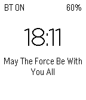

<!-- Generated by scripts/update_app_directory.py: do not edit by hand -->
[← All Pebble Developers](../developers.md)

# SferaDev

*1 watchface · Last updated 2026-10-11 · [About these lists](../about-app-lists.md)*

Links: [Pebble App Store](https://apps.repebble.com/apps/dev/sferadev_53e9dd7b6bc0a665fa00002a) · [GitHub (SferaDev)](https://github.com/SferaDev) · [Website (forum.xda-developers.com)](http://forum.xda-developers.com/pebble/pebble-development/xda-challenge-geek-time-t2846738)

<h2 class="app-name" id="app-53ff4974c20483149c000152"><a href="https://apps.repebble.com/53ff4974c20483149c000152">Geek The Time</a> v1.2</h2>
<a class="app-source" href="http://github.com/SferaDev/GeekDaTime" title="Source code" data-search-exclude>View source</a>

Watchface

GPL-2.0 Released 2014-08-28 Updated 2014-09-03

Runs on: Time 2, Pebble 2 Duo, Pebble 2, Time, Classic

Geek The Time is the ultimate geek WatchFace for your Pebble! - Check the time, bluetooth state, weather and battery! - Read random quotes or custom sentences! - Read headlines of XDA, TechCrunch…

