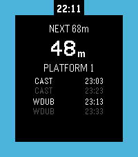

<!-- Generated by scripts/update_app_directory.py: do not edit by hand -->
[← All Pebble Developers](../developers.md)

# Sforzando!

*1 app · Last updated 2026-11-23 · [About these lists](../about-app-lists.md)*

Links: [Rebble App Store](https://apps.rebble.io/en_US/developer/56c21b13919c5ae50e00001a/1) · [GitHub (rbuckbailey)](https://github.com/rbuckbailey)

<h2 class="app-name" id="app-6afbf01197e7be0009ffc87f"><a href="https://apps.rebble.io/en_US/application/6afbf01197e7be0009ffc87f">BARTwatch</a> v0.1.1</h2>
<a class="app-source" href="https://github.com/rbuckbailey/BARTwatch" title="Source code" data-search-exclude>View source</a>

App · <a href="https://forum.rebble.io/t/1508" title="Discuss this app on the Rebble forum" data-search-exclude>Forum thread</a>

No licence Released 2026-11-17 Updated 2026-11-17 Rebble App Store

Runs on: Round 2, Time 2, Time Round, Time

Inspired by BART On Time and BART Runner, a BART tracker that does everything I need and nothing I don&#x27;t need. Maybe you need it too. Selects closest station automatically; select from the next…

