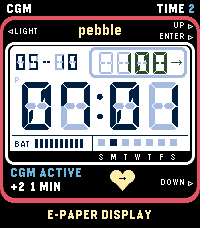
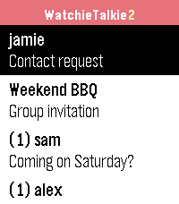
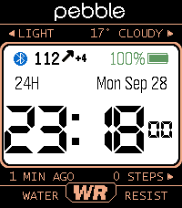

<!-- Generated by scripts/update_app_directory.py: do not edit by hand -->
[← All Pebble Developers](../developers.md)

# sgitaize

*3 watchfaces and 1 app · Last updated 2026-10-12 · [About these lists](../about-app-lists.md)*

Links: [Pebble App Store](https://apps.repebble.com/apps/dev/sgitaize_67c0d9b131804900097db57a) · [GitHub (sgitaize)](https://github.com/sgitaize)

<button type="button" data-filter="all" aria-pressed="true">All 4</button><button type="button" data-filter="watchface" aria-pressed="false">Watchfaces 3</button><button type="button" data-filter="watchapp" aria-pressed="false">Apps 1</button>

<label class="dev-sort">Sort by <select><option value="updated">Recently updated</option><option value="released">Newest release</option><option value="title">A–Z</option></select></label>

<h2 class="app-name" id="app-58fcfcc22c37487f815520db"><a href="https://apps.repebble.com/58fcfcc22c37487f815520db">CasioCGM</a> v2.3.6</h2>
<a class="app-source" href="https://github.com/sgitaize/casiocgm" title="Source code" data-search-exclude>View source</a>

Watchface

Released 2026-09-26 Updated 2026-10-05

Runs on: Time 2

Casio-style LCD watchface for Pebble Time 2 with live Nightscout CGM (blood glucose). As a diabetic you want a cool watchface too – that&#x27;s why CasioCGM exists. - Glucose value with trend arrow in…

<h2 class="app-name" id="app-5baaf5505dcf4454bdab0478"><a href="https://apps.repebble.com/5baaf5505dcf4454bdab0478">WatchieTalkie2</a> v1.7.0</h2>
<a class="app-source" href="https://github.com/sgitaize/Pebble-WatchieTalkie" title="Source code" data-search-exclude>View source</a>

App

Released 2026-09-28 Updated 2026-10-04

Runs on: Round 2, Time 2, Pebble 2 Duo, Pebble 2, Time Round, Time, Classic

Walkie-talkie for your Pebble – with text. Pick a friend, press SELECT, speak: your words arrive as a text message on their watch. End-to-end encrypted, open source, and you can run your own…

<h2 class="app-name" id="app-68c5e8d5474b97000932ae2c"><a href="https://apps.repebble.com/68c5e8d5474b97000932ae2c">Nightscout Supercgm</a> v2.6</h2>
<a class="app-source" href="https://github.com/sgitaize/Nightscout-supercgm" title="Source code" data-search-exclude>View source</a>

Watchface · <a href="https://forum.rebble.io/t/588" title="Discuss this app on the Rebble forum" data-search-exclude>Forum thread</a>

Released 2025-09-13 Updated 2026-09-28

Runs on: Round 2, Time 2, Pebble 2 Duo, Pebble 2, Time Round, Time, Classic

The ultimate Nightscout watchface for every Pebble. Five fully configurable rows — each independently set to any data source you need, in your color. ROWS (pick any per slot) • Nightscout BG —…

<h2 class="app-name" id="app-49c4f560ff4141548025f29f"><a href="https://apps.repebble.com/49c4f560ff4141548025f29f">91 Dub CGM</a> v1.1.0</h2>
<a class="app-source" href="https://github.com/sgitaize/dubv4cgm" title="Source code" data-search-exclude>View source</a>

Watchface

Released 2026-09-28 Updated 2026-09-28

Runs on: Time 2

The classic 91 Dub look for Pebble Time 2 – now with live Nightscout CGM (blood glucose). As a diabetic you want a cool watchface too. - Glucose value with trend arrow and delta in the panel…

