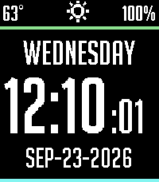

<!-- Generated by scripts/update_app_directory.py: do not edit by hand -->
[← All Pebble Developers](../developers.md)

# shadedurza

*1 watchface · Last updated 2026-10-11 · [About these lists](../about-app-lists.md)*

Links: [Pebble App Store](https://apps.repebble.com/apps/dev/shadedurza_b1e7b48840fc81f98a4daaac) · [GitHub (shadedurza)](https://github.com/shadedurza)

<h2 class="app-name" id="app-32d78a4ded604ff6a4222f0b"><a href="https://apps.repebble.com/32d78a4ded604ff6a4222f0b">Clean and Smart with seconds</a> v2.54.0</h2>
<a class="app-source" href="https://github.com/shadedurza/Clean_and_Smart_seconds" title="Source code" data-search-exclude>View source</a>

Watchface

Released 2026-09-23 Updated 2026-09-24

Runs on: Round 2, Time 2, Pebble 2 Duo, Pebble 2, Time Round, Time, Classic

Orignal watchface designed by Paul Joel and coded by Comfortably Numb. This version simply adds seconds.

