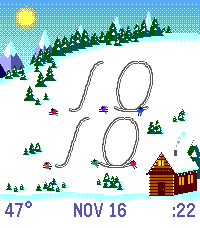

<!-- Generated by scripts/update_app_directory.py: do not edit by hand -->
[← All Pebble Developers](../developers.md)

# ShadowPeak100

*1 watchface · Last updated 2026-11-23 · [About these lists](../about-app-lists.md)*

Links: [Pebble App Store](https://apps.repebble.com/apps/dev/shadowpeak100_97b031e54d60024a54b73e42) · [GitHub (shadowpeak100)](https://github.com/shadowpeak100)

<h2 class="app-name" id="app-d37d952aa6c045608e27e83a"><a href="https://apps.repebble.com/d37d952aa6c045608e27e83a">Ski Time</a> v1.0.0</h2>
<a class="app-source" href="https://github.com/shadowpeak100/ski-time" title="Source code" data-search-exclude>View source</a>

Watchface

MIT Released 2026-11-16 Updated 2026-11-16

Runs on: Time 2

A watch face that tells the time with skiers that move down a mountain. Filled with fun animations, this is a great way to tell the time while enjoying your winter months.

