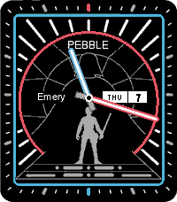
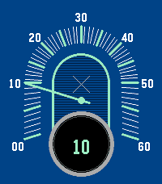

<!-- Generated by scripts/update_app_directory.py: do not edit by hand -->
[← All Pebble Developers](../developers.md)

# Shapeepo

*2 watchfaces · Last updated 2026-10-12 · [About these lists](../about-app-lists.md)*

Links: [Pebble App Store](https://apps.repebble.com/apps/dev/shapeepo_9d7e341ca44f84fd81f55906) · [GitHub (shapeepo)](https://github.com/shapeepo)

<button type="button" data-filter="all" aria-pressed="true">All 2</button><button type="button" data-filter="watchface" aria-pressed="false">Watchfaces 2</button><button type="button" data-filter="watchapp" aria-pressed="false" disabled>Apps 0</button>

<label class="dev-sort">Sort by <select><option value="updated">Recently updated</option><option value="released">Newest release</option><option value="title">A–Z</option></select></label>

<h2 class="app-name" id="app-2985c1ae5ff44cb9b4b89251"><a href="https://apps.repebble.com/2985c1ae5ff44cb9b4b89251">Citizen Star Wars</a> v1.1.0</h2>
<a class="app-source" href="https://github.com/shapeepo/citizen-star-wars" title="Source code" data-search-exclude>View source</a>

Watchface

Released 2026-05-08 Updated 2026-05-08

Runs on: Time 2

Based on Citizen Star Wars face

<h2 class="app-name" id="app-8d0aa31ae4834764be9292b9"><a href="https://apps.repebble.com/8d0aa31ae4834764be9292b9">Xeric Jump Hour</a> v1.2</h2>
<a class="app-source" href="https://github.com/shapeepo/xeric-jump-hour" title="Source code" data-search-exclude>View source</a>

Watchface

Released 2026-04-30 Updated 2026-04-30

Runs on: Round 2, Time 2, Pebble 2 Duo, Pebble 2, Time Round, Time, Classic

Based on Xeric Retroscope Jump Hour (designed with help from claude code, wip)

