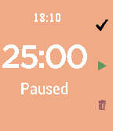

<!-- Generated by scripts/update_app_directory.py: do not edit by hand -->
[← All Pebble Developers](../developers.md)

# Shawn Xiang

*1 app · Last updated 2026-10-11 · [About these lists](../about-app-lists.md)*

Links: [Pebble App Store](https://apps.repebble.com/apps/dev/shawn-xiang_56ad39de5319ec4ac1000053) · [GitHub (shawnzxiang)](https://github.com/shawnzxiang) · [Website (shawnxiang.com)](http://shawnxiang.com/)

<h2 class="app-name" id="app-5772e69e6c21047b2c00040d"><a href="https://apps.repebble.com/5772e69e6c21047b2c00040d">Simple Pomodoro</a> v1.5</h2>
<a class="app-source" href="https://github.com/shawnzxiang/pebble-pomodoro" title="Source code" data-search-exclude>View source</a>

App

Released 2016-06-28 Updated 2016-09-25

Runs on: Round 2, Time 2, Pebble 2 Duo, Pebble 2, Time Round, Time, Classic

This pomodoro app in pebble can: Customize time (work, rest, long rest and long rest frequency) and UI Screen Color Ability to take a long break after several iterations Shows the time and status…

