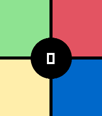
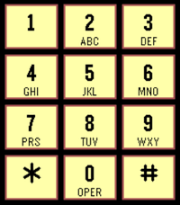

<!-- Generated by scripts/update_app_directory.py: do not edit by hand -->
[← All Pebble Developers](../developers.md)

# sheppoor

*2 apps · Last updated 2026-10-12 · [About these lists](../about-app-lists.md)*

Links: [Pebble App Store](https://apps.repebble.com/apps/dev/sheppoor_412a498a797c10f09b9da5a7) · [GitHub (sheppoor)](https://github.com/sheppoor)

<button type="button" data-filter="all" aria-pressed="true">All 2</button><button type="button" data-filter="watchface" aria-pressed="false" disabled>Watchfaces 0</button><button type="button" data-filter="watchapp" aria-pressed="false">Apps 2</button>

<label class="dev-sort">Sort by <select><option value="updated">Recently updated</option><option value="released">Newest release</option><option value="title">A–Z</option></select></label>

<h2 class="app-name" id="app-75a3c14b89724bd8b9c42be6"><a href="https://apps.repebble.com/75a3c14b89724bd8b9c42be6">SimonTime</a> v1.0.1</h2>
<a class="app-source" href="https://github.com/sheppoor/SimonTime" title="Source code" data-search-exclude>View source</a>

App

Released 2026-07-23 Updated 2026-07-25

Runs on: Round 2, Time 2

Classic pattern memory game with touch and sound. High score. Up button to see/change speaker on/off state. Select button or center tap to start a new game. Designed for Pebble Time 2, looks even…

<h2 class="app-name" id="app-917ae403a3024a9d979c57d7"><a href="https://apps.repebble.com/917ae403a3024a9d979c57d7">Touch Tone</a> v1.0.2</h2>
<a class="app-source" href="https://github.com/sheppoor/touch-tone" title="Source code" data-search-exclude>View source</a>

App

Released 2026-06-13 Updated 2026-06-13

Runs on: Time 2

Plays the touch tone classic sounds on an old 12-button telephone. Experience those dulcet tones from the before times.

