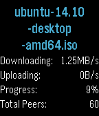

<!-- Generated by scripts/update_app_directory.py: do not edit by hand -->
[← All Pebble Developers](../developers.md)

# Shikataganai

*1 app · Last updated 2026-10-12 · [About these lists](../about-app-lists.md)*

Links: [Pebble App Store](https://apps.repebble.com/apps/dev/shikataganai_52ffbeb260495fe03c0001ab) · [GitHub (ishepard)](https://github.com/ishepard)

<h2 class="app-name" id="app-54eb8c6b87bfd3bde300009f"><a href="https://apps.repebble.com/54eb8c6b87bfd3bde300009f">Transmission Torrent</a> v3.1</h2>
<a class="app-source" href="https://github.com/ishepard/TransmissionTorrent" title="Source code" data-search-exclude>View source</a>

App

MIT Released 2015-02-23 Updated 2015-08-28

Runs on: Time 2, Pebble 2 Duo, Pebble 2, Time, Classic

A remote control for Transmission, with support for the Timeline! Features: - List of torrents - Details for each torrent, such as speed and progress - Start, pause and remove any torrent …

