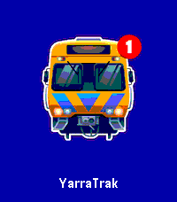

<!-- Generated by scripts/update_app_directory.py: do not edit by hand -->
[← All Pebble Developers](../developers.md)

# ShinkoNet

*1 app · Last updated 2026-10-11 · [About these lists](../about-app-lists.md)*

Links: [Pebble App Store](https://apps.repebble.com/apps/dev/shinkonet_3d56e6eebb8d1a10961ee37a) · [GitHub (ShinkoNet)](https://github.com/ShinkoNet) · [Website (ptv.netcavy.net)](https://ptv.netcavy.net/)

<h2 class="app-name" id="app-abc5ed3b095e4bd380de6909"><a href="https://apps.repebble.com/abc5ed3b095e4bd380de6909">YarraTrak</a> v2.0</h2>
<a class="app-source" href="https://github.com/ShinkoNet/YarraTrak" title="Source code" data-search-exclude>View source</a>

App

No licence Released 2026-04-07 Updated 2026-04-25

Runs on: Round 2, Time 2, Pebble 2 Duo, Pebble 2, Time Round, Time, Classic

Real-time Melbourne public transport departures on your Pebble smartwatch. YarraTrak shows live train, tram, and V/Line departure times directly on your wrist. Configure your favourite stations…

